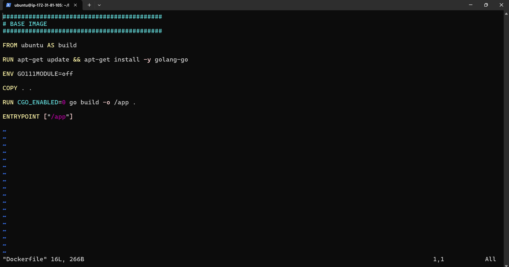
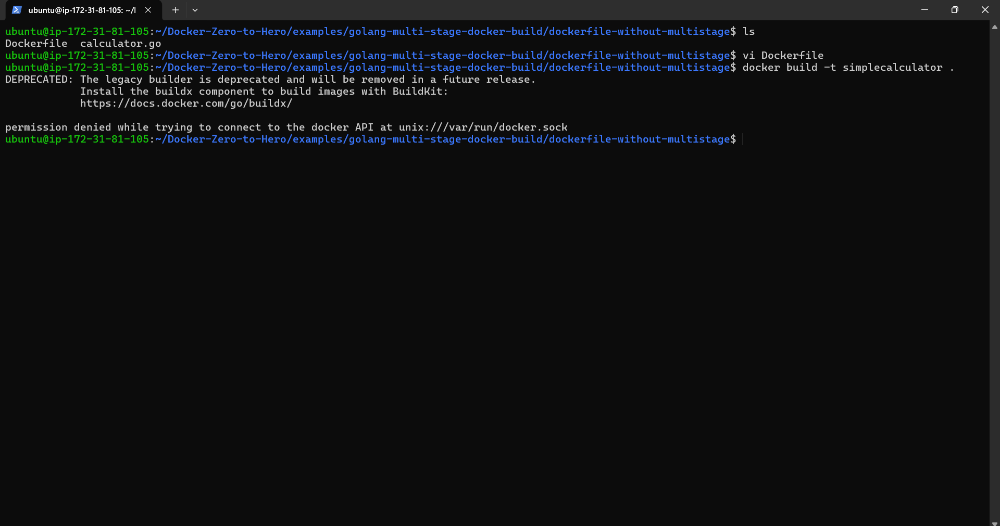
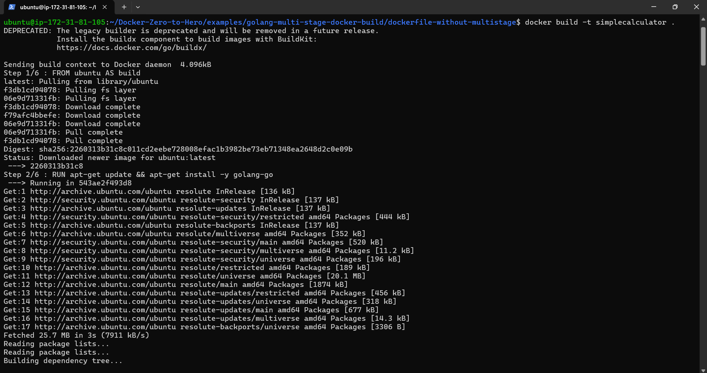
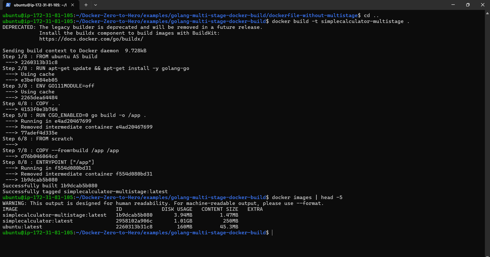

# Multi Stage Docker Build

The main purpose of choosing a golang based applciation to demostrate this example is golang is a statically-typed programming language that does not require a runtime in the traditional sense. Unlike dynamically-typed languages like Python, Ruby, and JavaScript, which rely on a runtime environment to execute their code, Go compiles directly to machine code, which can then be executed directly by the operating system.

So the real advantage of multi stage docker build and distro less images can be understand with a drastic decrease in the Image size.

